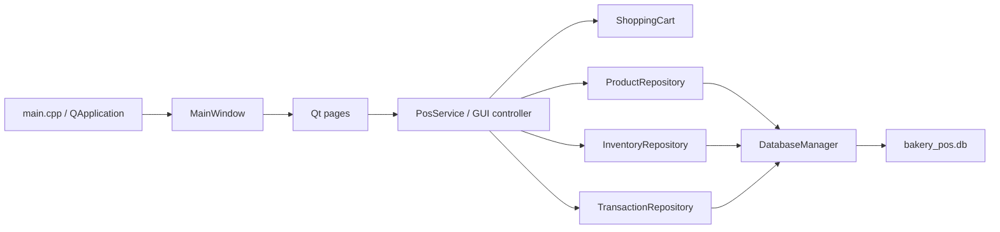

# Phase 3 Design

## Architecture



Qt stays at the presentation edge. A new `PosService` owns or coordinates repository access and the in-memory cart, exposing typed results instead of Qt SQL or widgets.

## Proposed Files

- `CMakeLists.txt` or a Qt-aware build wrapper
- `gui/MainWindow.h/.cpp/.ui`
- `gui/ProductPage.h/.cpp/.ui`
- `gui/InventoryPage.h/.cpp/.ui`
- `gui/HistoryPage.h/.cpp/.ui`
- `gui/PosController.h/.cpp`
- Existing model and repository files unchanged where possible

If Qt `.ui` files are avoided, equivalent widget construction may use C++ layouts. CMake should use `AUTOMOC`, `AUTOUIC`, and `AUTORCC`.

## Qt Entry Point

`main.cpp` selects only the desktop entry point:

```cpp
int main(int argc, char* argv[]) {
    QApplication app(argc, argv);
    MainWindow window;
    window.show();
    return app.exec();
}
```

Console compatibility may remain behind `POS::run()` or a build/configuration entry point. It must not depend on Qt.

## POS Controller

`PosController`/`PosService` provides methods for:

- active catalog and stock refresh
- cart add/update/remove/view
- stock and active-product validation
- atomic checkout
- product and inventory mutations
- history and daily report retrieval

Repository failures are returned as `Result<T>`-style values or explicit success/error structures. Qt signals emit user-facing success/error state only.

## UI

- Professional sidebar navigation.
- Point-of-sale page: product grid/list, cart table, quantity controls, payment panel, and checkout button.
- Product management page: searchable table and create/edit/deactivate form.
- Inventory page: stock table, low/out-of-stock highlighting, restock and adjustment controls.
- History page: transaction table, detail panel/receipt preview, and daily report summary.

## Visual System

The GUI shall use a modern pastel bakery aesthetic that remains professional and operational. Decorative styling must never reduce contrast, table readability, or control discoverability.

### Palette

- **Primary accent:** pastel pink, approximately `#E7A6B3`
- **Secondary accent:** blush pink, approximately `#F3CDD5`
- **Strong accent:** dusty rose, approximately `#C98996`
- **Main background:** warm cream, approximately `#FFF9F2`
- **Panel background:** off-white, approximately `#FFFCF8`
- **Alternate surface:** light beige, approximately `#F5EDE3`
- **Primary text:** dark cocoa, approximately `#4A3935`
- **Secondary text:** muted charcoal, approximately `#6D625F`
- **Borders/dividers:** soft cocoa-beige, approximately `#DFCFC5`
- **Success:** muted sage, approximately `#7A9B7E`
- **Warning:** soft amber, approximately `#C9965B`
- **Error:** muted rose-red, approximately `#A95F68`

Use no pure black as the default text color and preserve accessible contrast for information, labels, and control states.

### Typography

- Use a clean, modern Qt font with rounded characteristics, such as Segoe UI on Windows or a packaged rounded sans-serif alternative.
- Set clear type hierarchy: title, page heading, card heading, body, label, and compact table text.
- Use regular weight for body content and medium/bold weight only for headings or emphasized values.
- Keep labels concise and align numeric values consistently, especially in tables and checkout summaries.

### Shape and Depth

- Use 10–14 px rounded corners for cards and panels.
- Use 8–10 px rounded corners for buttons and input fields.
- Apply gentle 1 px borders and subtle, sparse shadows only to elevate primary panels and important controls.
- Use consistent spacing, such as 16 px page padding, 12 px card padding, and 8 px control gaps.
- Avoid large gradients, heavy blur, excessive outlines, or decorative imagery that competes with the POS workflow.

### Interactive States

Every button, navigation item, input field, table row, and selectable card shall have visible:

- **Normal:** cream/off-white surface with a clear soft border.
- **Hover:** slightly stronger dusty-rose or blush-tint highlight.
- **Pressed:** a darker dusty-rose tint and a small inset or reduced elevation effect.
- **Focused:** a 2 px dusty-rose outline or keyboard-focus ring with sufficient contrast.
- **Disabled:** muted beige background, muted text, and no hover elevation or pressed behavior.

Primary actions use dusty rose or pastel pink with dark cocoa text. Secondary actions use off-white/beige with cocoa text. Destructive actions use muted rose-red only when action consequence is clear.

### Cards and Panels

- Group related POS, product, inventory, and report content into rounded cards.
- Keep a consistent internal grid and avoid nested panels with competing depth.
- Use warm cream for page surfaces, off-white for primary cards, and light beige for secondary sections or selected rows.
- Separate dense data with thin, low-contrast borders rather than excessive box shadows.

### Page-Specific Consistency

- **Main navigation:** warm cream sidebar, blush/dusty-rose selection state, dark cocoa text, and clear icons or text labels.
- **POS page:** prominent pastel checkout panel and a scannable cart table.
- **Product page:** clean searchable table with restrained edit/deactivate controls.
- **Inventory page:** stock counts with muted amber for low stock (30 units or fewer, excluding zero) and muted rose-red for out-of-stock status.
- **History/reports:** neutral transaction tables, snapshot data in off-white cards, and understated sales summaries.

QSS/theme configuration should define shared palette constants or a single application stylesheet. The visual language shall remain consistent across desktop widths and high-DPI scaling.

## Build Configuration

Recommended Qt 6 packages:

- Qt 6 Core
- Qt 6 Gui
- Qt 6 Widgets
- Qt 6 Test, optional

Link targets:

- `Qt6::Core`
- `Qt6::Gui`
- `Qt6::Widgets`
- SQLite3

Qt is not currently found on the current PATH. A developer install or Qt maintenance tool must provide CMake package discovery.

## Compatibility Risks

- `POS` currently mixes console input/output with catalog and checkout logic.
- `main.cpp` currently starts `POS::run()` and must gain Qt or remain a separate executable target.
- Menu-only input helpers are private and cannot be reused by Qt without a controller boundary.
- Currency currently uses `double`; repository checkout already converts to cents, so UI formatting must continue through cents-safe display helpers.
- Qt on Windows requires deploying its runtime DLLs and platform plugins.
- Tests must avoid constructing a real GUI where repository/controller tests are sufficient.
