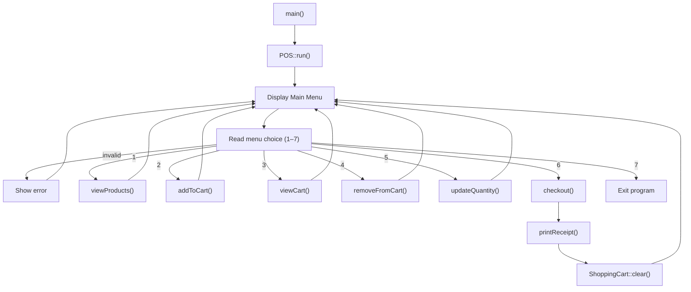
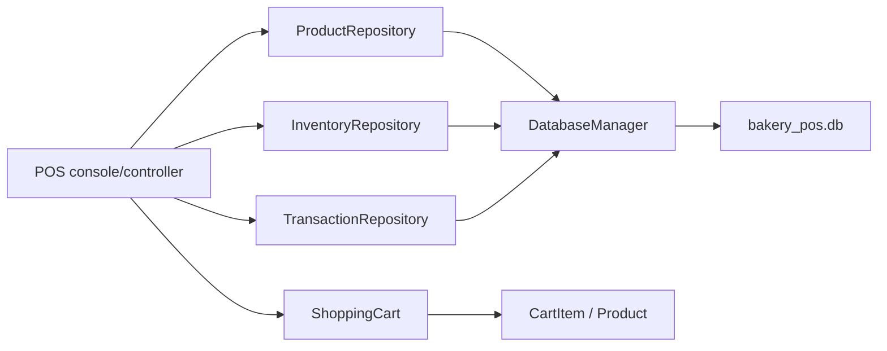

# Design Document

## Overview

The Crombi Bakery POS system is a console-based C++17 application for a small bakery cashier. It is structured as a set of cooperating classes compiled from multiple `.h`/`.cpp` file pairs and driven by a single `main.cpp`. All data lives in memory for the duration of one run; there is no file I/O, no database, and no external libraries.

The system follows a classic **Model → Controller → View** separation in a single-process console loop:

- **Model**: `Product`, `CartItem`, `ShoppingCart` — pure data and operations.
- **Controller / Application driver**: `POS` — owns the catalog, the cart, and the transaction counter; runs the main menu loop.
- **View**: `POS` output methods — format and print tables, receipts, and messages to `std::cout`.

The cashier interacts entirely through numbered menu choices and typed IDs/amounts. The program loops indefinitely until the cashier selects option 7 (Exit).

---

## Architecture

### High-Level Flow



### File Dependency Graph

```
main.cpp
  └── POS.h / POS.cpp
        ├── ShoppingCart.h / ShoppingCart.cpp
        │     └── CartItem.h / CartItem.cpp
        │           └── Product.h / Product.cpp
        └── Product.h / Product.cpp  (catalog initialization)
```

Each header includes only what it directly needs. `main.cpp` includes only `POS.h`.

---

## Components and Interfaces

### Product

Represents a single bakery item. Immutable after construction — the catalog never changes.

**File**: `Product.h` / `Product.cpp`

```cpp
class Product {
public:
    Product(std::string id, std::string name, double price);

    std::string getId()    const;
    std::string getName()  const;
    double      getPrice() const;

private:
    std::string id_;
    std::string name_;
    double      price_;
};
```

- No setters — products are read-only once created.
- Price is stored as `double` and always displayed with two decimal places.

---

### CartItem

Pairs a `Product` with a mutable quantity. Owns the subtotal calculation.

**File**: `CartItem.h` / `CartItem.cpp`

```cpp
class CartItem {
public:
    CartItem(const Product& product, int quantity);

    std::string getProductId()   const;
    std::string getProductName() const;
    double      getUnitPrice()   const;
    int         getQuantity()    const;
    double      getSubtotal()    const;   // unit_price * quantity

    void setQuantity(int newQty);         // replaces quantity (Requirement 6.5)
    void addQuantity(int additionalQty);  // merges quantity (Requirement 3.6)

private:
    Product product_;
    int     quantity_;
};
```

- `getSubtotal()` computes on the fly: `product_.getPrice() * quantity_`.
- Both mutation methods enforce positive-integer invariants by callers, not internally (validation is handled by `POS`).

---

### ShoppingCart

Manages the collection of `CartItem` objects. Uses `std::vector<CartItem>` as the backing store.

**File**: `ShoppingCart.h` / `ShoppingCart.cpp`

```cpp
class ShoppingCart {
public:
    void   addItem(const Product& product, int quantity); // add or merge
    bool   removeItem(const std::string& productId);      // returns false if not found
    bool   updateItem(const std::string& productId, int newQty); // returns false if not found
    void   clear();

    bool   isEmpty()                        const;
    bool   containsProduct(const std::string& productId) const;
    double getOrderTotal()                  const;
    const  std::vector<CartItem>& getItems() const;

private:
    std::vector<CartItem> items_;

    // Returns iterator to item with given productId, or items_.end() if not found.
    std::vector<CartItem>::iterator findItem(const std::string& productId);
};
```

- `addItem` calls `findItem`. If found, delegates to `CartItem::addQuantity`. If not found, constructs and pushes a new `CartItem`.
- `getOrderTotal` iterates all items and sums `getSubtotal()`.
- `clear` calls `items_.clear()`.

---

### POS

Top-level application class. Owns the catalog (`std::vector<Product>`), a `ShoppingCart`, and a `transactionId_` counter.

**File**: `POS.h` / `POS.cpp`

```cpp
class POS {
public:
    POS();        // initializes catalog, sets transactionId_ = 1
    void run();   // starts and drives the main menu loop

private:
    std::vector<Product> catalog_;
    ShoppingCart         cart_;
    int                  transactionId_;

    // Menu action handlers
    void viewProducts()     const;
    void addToCart();
    void viewCart()         const;
    void removeFromCart();
    void updateQuantity();
    void checkout();

    // Helpers
    const Product* findProductById(const std::string& id) const;
    void           printReceipt(double cashAmount) const;
    static std::string formatCurrency(double amount); // "PHP X.XX"
    static std::string getCurrentDateTime();           // from ctime

    // Input validation helpers
    static int    readMenuChoice();      // returns 1–7 or -1 on bad input
    static int    readPositiveInt(const std::string& prompt);  // loops until valid
    static double readCashAmount(double minimum);               // loops until >= minimum
    static std::string readProductId(const std::string& prompt);
};
```

**Catalog initialization** happens in the `POS` constructor:

```cpp
POS::POS() : transactionId_(1) {
    catalog_ = {
        Product("P001", "Chocolate Chip Cookie", 65.00),
        Product("P002", "Double Chocolate Cookie", 70.00),
        Product("P003", "Red Velvet Cookie", 70.00),
        Product("P004", "S'mores Cookie", 75.00),
        Product("P005", "Brookies", 75.00)
    };
}
```

---

### main.cpp

```cpp
#include "POS.h"

int main() {
    POS pos;
    pos.run();
    return 0;
}
```

No business logic lives here — it only instantiates `POS` and delegates.

---

## Data Models

### In-Memory Object Graph

```
POS
 ├── catalog_ : vector<Product>   [5 entries, immutable]
 ├── cart_    : ShoppingCart
 │    └── items_ : vector<CartItem>
 │         └── CartItem
 │              └── product_ : Product  (copy)
 │              └── quantity_ : int
 └── transactionId_ : int
```

`CartItem` stores a **copy** of `Product` (not a pointer). This is safe because the catalog never changes, and copies keep `CartItem` self-contained and easy to reason about.

### Key Data Types

| Field | Type | Notes |
|---|---|---|
| Product ID | `std::string` | P001–P005 |
| Product name | `std::string` | Fixed strings |
| Price / monetary value | `double` | Formatted with `std::fixed << std::setprecision(2)` |
| Quantity | `int` | Must be > 0 |
| Transaction ID | `int` | Starts at 1, increments on each successful checkout |
| Timestamp | `std::string` | From `std::ctime` / `std::localtime` |

### Currency Formatting

All monetary output passes through a single helper:

```cpp
std::string POS::formatCurrency(double amount) {
    std::ostringstream oss;
    oss << "PHP " << std::fixed << std::setprecision(2) << amount;
    return oss.str();
}
```

This keeps the format (`PHP X.XX`) consistent across all display contexts.

---

## Correctness Properties

*A property is a characteristic or behavior that should hold true across all valid executions of a system — essentially, a formal statement about what the system should do. Properties serve as the bridge between human-readable specifications and machine-verifiable correctness guarantees.*

### Property 1: Catalog immutability

*For any* sequence of cart operations (add, remove, update, checkout), the five catalog products must remain identical to their initial state before and after every operation.

**Validates: Requirements 1.3**

---

### Property 2: Invalid menu input is always rejected

*For any* integer input that is not in the range 1–7, the input validator must classify it as invalid and not dispatch any menu action.

**Validates: Requirements 2.3**

---

### Property 3: Invalid Product_ID is always rejected

*For any* string that does not exactly match one of `P001`–`P005`, attempting to add, remove, or update that product in the cart must leave the cart completely unchanged.

**Validates: Requirements 3.2, 5.2, 6.2**

---

### Property 4: Non-positive quantity is always rejected

*For any* quantity value that is not a positive integer (i.e., zero, negative, or non-numeric), attempting to add or update a cart item with that quantity must leave the cart completely unchanged.

**Validates: Requirements 3.4, 6.4**

---

### Property 5: New item addition correctness

*For any* valid product not currently in the cart, and *for any* positive integer quantity, adding that product must result in the cart containing exactly one CartItem for that product with the given quantity and a subtotal equal to `unit_price × quantity`.

**Validates: Requirements 3.5**

---

### Property 6: Duplicate item quantity accumulation

*For any* CartItem already in the cart with quantity Q, and *for any* positive integer delta, adding the same product with delta must result in the CartItem's quantity being exactly `Q + delta`.

**Validates: Requirements 3.6**

---

### Property 7: Currency formatting invariant

*For any* non-negative `double` value representing a monetary amount, the formatted string must match the pattern `PHP \d+\.\d{2}` (a PHP prefix followed by digits and exactly two decimal places).

**Validates: Requirements 4.3, 10.7**

---

### Property 8: Cart display completeness

*For any* non-empty cart, the cart display output must contain the Product_ID, name, unit price, quantity, and subtotal for every CartItem, plus the correct Order_Total (sum of all subtotals).

**Validates: Requirements 4.1**

---

### Property 9: Removal correctness

*For any* CartItem present in the cart, removing it by Product_ID must result in that product no longer appearing in the cart, with all other items unchanged.

**Validates: Requirements 5.3**

---

### Property 10: Quantity update correctness

*For any* CartItem in the cart and *for any* new positive integer quantity N, updating that item must set its quantity to exactly N and its subtotal to exactly `unit_price × N`.

**Validates: Requirements 6.5**

---

### Property 11: Insufficient cash is always rejected

*For any* non-empty cart with a known Order_Total T, and *for any* cash amount C where `C < T`, the checkout must reject the payment and not proceed to receipt generation.

**Validates: Requirements 7.4**

---

### Property 12: Change calculation correctness

*For any* valid payment where cash amount C ≥ Order_Total T, the computed change must equal exactly `C − T`.

**Validates: Requirements 7.5**

---

### Property 13: Receipt completeness

*For any* completed checkout, the printed receipt string must contain the store header (`Crombi Bakery`), the Transaction_ID, a timestamp, all CartItems with quantity/unit price/subtotal, the Order_Total, the cash amount, the change, and a thank-you message.

**Validates: Requirements 8.1, 8.2, 8.3**

---

### Property 14: Transaction ID increment

*For any* N successful checkouts in a single session, the Transaction_ID after the Nth checkout must equal the starting Transaction_ID plus N.

**Validates: Requirements 8.4**

---

### Property 15: Cart cleared after checkout

*For any* non-empty cart that completes a successful checkout, the cart must be empty immediately afterward.

**Validates: Requirements 8.5**

---

### Property 16: System survives any invalid input sequence

*For any* sequence of inputs that includes invalid values (non-numeric strings, out-of-range numbers, unknown product IDs), the POS must remain in a valid, operational state after each invalid input — no crash, no abnormal termination, no corrupted cart state.

**Validates: Requirements 9.1, 9.2, 9.3**

---

## Error Handling

All invalid input is handled through dedicated `POS` input helpers. The core design principle is: **validation happens before any state mutation**.

### Menu Choice

```
readMenuChoice():
  1. Try to parse an integer from cin
  2. If cin fails → clear() + ignore() the stream, return -1
  3. If integer not in [1, 7] → return -1
  4. Display error message if -1, re-show menu
```

The menu loop never calls a handler with an invalid choice.

### Product ID

```
addToCart() / removeFromCart() / updateQuantity():
  1. Read a string from cin (strings never cause stream failure)
  2. Call findProductById(id) or cart_.containsProduct(id)
  3. If not found → display error, return to menu
  4. Otherwise → proceed
```

### Quantity / Cash Amount

Both `readPositiveInt` and `readCashAmount` use a **retry loop**:

```
readPositiveInt(prompt):
  loop:
    display prompt
    try read integer from cin
    if cin fails → clear + ignore stream → display error → continue
    if value <= 0 → display error → continue
    return value
```

```
readCashAmount(minimum):
  loop:
    display prompt
    try read double from cin
    if cin fails → clear + ignore stream → display error → continue
    if value < minimum → display error → continue
    return value
```

This means these helpers never return until a valid value is obtained, so callers are guaranteed a valid value.

### Stream State Recovery

Whenever `cin` enters a fail state (the cashier types letters where a number is expected):

```cpp
std::cin.clear();
std::cin.ignore(std::numeric_limits<std::streamsize>::max(), '\n');
```

This clears the error flag and discards the bad input from the buffer, preventing an infinite silent loop.

---

## Testing Strategy

This feature is a C++17 console application. The core business logic (cart operations, subtotal/total calculations, input validation, receipt formatting) is well-suited for property-based testing because the behavior depends on input values and there are clear universal properties. UI-level interactions (menu display, prompts) are better covered by example-based tests.

### Unit and Property-Based Testing

**Recommended library**: [rapidcheck](https://github.com/emil-e/rapidcheck) (a header-only C++ property-based testing library) combined with a lightweight unit test framework such as [doctest](https://github.com/doctest/doctest).

**Property test configuration**: Each property test must run a minimum of **100 iterations** with randomly generated inputs. Each test must reference its design document property in a comment using the tag format:

> `// Feature: bakery-pos-system, Property N: <property text>`

### Property Tests (one test per property)

| Property | Test focus | Key generators |
|---|---|---|
| P1: Catalog immutability | Catalog unchanged after any cart ops | Random sequences of add/remove/update calls |
| P2: Invalid menu input rejected | Integers outside [1,7] rejected | `rc::gen::inRange` outside [1,7] |
| P3: Invalid Product_ID rejected | Random non-matching strings leave cart unchanged | Random alphanumeric strings not in {P001–P005} |
| P4: Non-positive quantity rejected | Zero/negative values leave cart unchanged | `rc::gen::nonPositive<int>()` |
| P5: New item addition | Quantity and subtotal correct after add | Random valid product + random positive int |
| P6: Quantity accumulation | Old + delta = new quantity | Random existing cart + random positive delta |
| P7: Currency formatting | Output matches `PHP \d+\.\d{2}` | Random non-negative doubles |
| P8: Cart display completeness | All fields present, total correct | Random populated carts |
| P9: Removal correctness | Item gone, others intact | Random cart + random item from cart |
| P10: Quantity update correctness | New quantity and subtotal exact | Random cart item + random new quantity |
| P11: Insufficient cash rejected | Cash < Total always rejected | Random cart + cash in range [0, total) |
| P12: Change calculation | change == cash − total | Random cart + cash >= total |
| P13: Receipt completeness | All required fields in receipt string | Random completed transactions |
| P14: Transaction ID increment | ID increases by exactly N over N checkouts | Random N in [1, 20] |
| P15: Cart cleared after checkout | Cart empty after valid checkout | Random non-empty cart |
| P16: System survives invalid input | Valid state after any bad input | Random mix of valid and invalid input sequences |

### Example-Based Unit Tests

Cover specific concrete scenarios that are either not universal properties or serve as good regression anchors:

- Menu displays all seven options
- Empty cart shows "Cart is empty."
- Empty cart checkout is blocked with error
- Checkout re-prompts until sufficient cash is entered
- Receipt contains "Crombi Bakery" header and "thank you" message
- Currency format for exact values: 65.00 → `PHP 65.00`, 0.00 → `PHP 0.00`

### Integration / Smoke Tests

- Five products initialized with correct IDs, names, and prices
- File structure: all required `.h`/`.cpp` files compile without error
- Program does not crash on a complete happy-path session (view → add → checkout → exit)

---

# Phase 2 Design

## Phase 2 Architecture

The existing model and console layers remain separate from persistence:



- `POS` continues to drive input and output and coordinate operations.
- `DatabaseManager` owns the SQLite connection, schema initialization, transactions, and low-level statement helpers.
- `ProductRepository` handles product CRUD and search.
- `InventoryRepository` handles stock reads, restocking, adjustments, logs, and stock validation.
- `TransactionRepository` handles transaction and transaction-item persistence and reports.
- Repositories must not display console prompts or format receipts.

## Database Schema

```sql
CREATE TABLE categories (
    category_id INTEGER PRIMARY KEY,
    name TEXT NOT NULL UNIQUE
);

CREATE TABLE products (
    product_id TEXT PRIMARY KEY,
    category_id INTEGER NOT NULL,
    name TEXT NOT NULL,
    price_cents INTEGER NOT NULL CHECK(price_cents >= 0),
    active INTEGER NOT NULL DEFAULT 1 CHECK(active IN (0, 1)),
    FOREIGN KEY(category_id) REFERENCES categories(category_id)
);

CREATE TABLE inventory (
    product_id TEXT PRIMARY KEY,
    quantity INTEGER NOT NULL CHECK(quantity >= 0),
    FOREIGN KEY(product_id) REFERENCES products(product_id)
);

CREATE TABLE inventory_logs (
    log_id INTEGER PRIMARY KEY,
    product_id TEXT NOT NULL,
    quantity_change INTEGER NOT NULL,
    reason TEXT NOT NULL,
    resulting_quantity INTEGER NOT NULL CHECK(resulting_quantity >= 0),
    logged_at TEXT NOT NULL,
    FOREIGN KEY(product_id) REFERENCES products(product_id)
);

CREATE TABLE transactions (
    transaction_id INTEGER PRIMARY KEY,
    transaction_date TEXT NOT NULL,
    order_total_cents INTEGER NOT NULL,
    cash_received_cents INTEGER NOT NULL,
    change_cents INTEGER NOT NULL
);

CREATE TABLE transaction_items (
    transaction_item_id INTEGER PRIMARY KEY,
    transaction_id INTEGER NOT NULL,
    product_id TEXT NOT NULL,
    product_name TEXT NOT NULL,
    unit_price_cents INTEGER NOT NULL,
    quantity INTEGER NOT NULL CHECK(quantity > 0),
    subtotal_cents INTEGER NOT NULL,
    FOREIGN KEY(transaction_id) REFERENCES transactions(transaction_id)
);
```

Money is stored in integer cents to avoid floating-point rounding. Existing `double` display behavior is converted at repository boundaries.

## Repository Interfaces

`DatabaseManager` provides open/close, foreign-key enablement, schema migration, prepared statement helpers, and begin/commit/rollback operations.

`ProductRepository` provides:

- `findById`
- `search`
- `getActive`
- `create`
- `update`
- `deactivate`

`InventoryRepository` provides:

- `getStock`
- `restock`
- `adjust`
- `logAdjustment`
- `deductStockForCheckout`

`TransactionRepository` provides:

- `createAtomic`
- `getById`
- `listByDateRange`
- `getSalesSummary`

## Atomic Checkout

Checkout uses an explicit SQLite transaction:

1. Recheck every cart item against current stock.
2. Insert the transaction and obtain its database ID.
3. Insert each transaction item with product ID and immutable name/price snapshots.
4. Deduct stock and insert inventory log entries.
5. Commit.
6. Only after commit, print the receipt and clear the in-memory cart.

Any validation or SQL failure calls rollback, keeps the cart unchanged, and returns an error to `POS`.

## Compatibility and Migration

- Keep `main.cpp`, `POS`, `Product`, `CartItem`, and `ShoppingCart` responsibilities intact.
- Replace the fixed `catalog_` initialization with repository-backed active-product loading.
- Database transaction IDs replace session-only IDs.
- Seed `P001`–`P005` once during first database initialization.
- Existing menu choices 1–7 remain functional; new management/history options should use submenus so existing behavior is preserved.
- SQLite and tests remain self-contained; no GUI or external framework is introduced.
